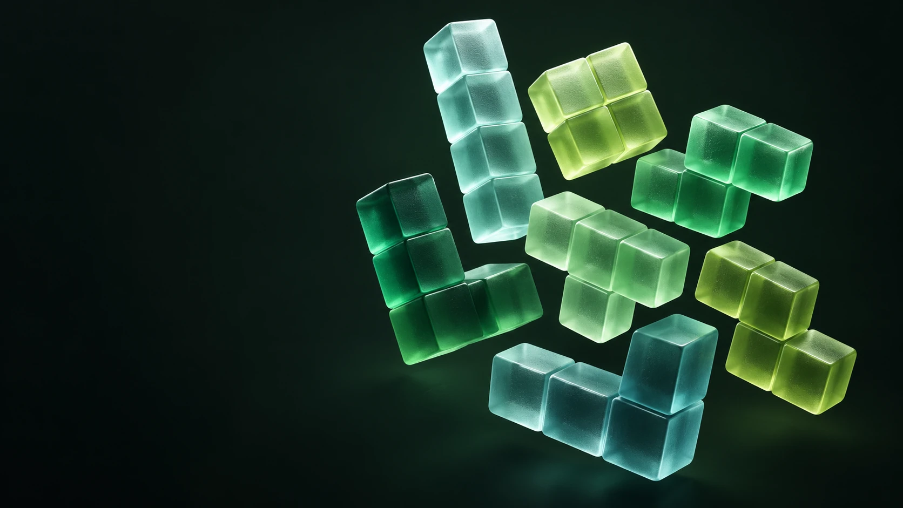

# Biquadris

**A turn-based falling-block duel, built in C++ and reimagined for the browser.**

[Play the live project](https://y68wu.github.io/Biquadris/) · [GitHub repository](https://github.com/y68wu/Biquadris) · [Engineering notes](docs/project-notes.md)



Biquadris is a two-player puzzle game created by **Chris Wu and Yan Cui** for **CS 246 at the University of Waterloo, Fall 2024**. The original project uses **C++20**, a command interface, and text and **X11** displays. Each player plans a move on an independent board, clears rows, and uses special actions to disrupt the other player.

This repository is its portfolio project page: an explanation of the original system, my contribution, and an interactive playground. The playable demo is a separate JavaScript adaptation of the game rules; it does not execute or compile the C++ binary.

## My contribution

I contributed across **all core modules** of the original project, working with Yan Cui to connect the pieces into a complete game:

- **Board and pieces:** grid representation, current and next blocks, movement, rotation, collision checks, line clearing, and scoring.
- **Game flow and interaction:** command interpretation, repetitions, player turns, restart behavior, and blind/heavy/force actions.
- **Difficulty:** sequence-driven and weighted random piece generation, level changes, and additional constraints at higher levels.
- **Presentation:** text and X11 rendering behind a shared display interface.

The project brought together object-oriented design, polymorphism, state management, and interface separation. [The engineering notes](docs/project-notes.md) map these responsibilities to the original source and distinguish the historical design report from the final implementation.

## Explore the playground

- Solo practice or a local two-player duel on one device.
- All seven tetrominoes, next-piece previews, and five difficulty levels.
- Turn-based movement: there is **no automatic falling timer**.
- Keyboard, touch buttons, or a command field with plain-language previews and immediate feedback.
- Landing ghosts, a guided two-row clear, and a best score saved in this browser.
- Blind, heavy, and force attacks after clearing two or more rows in one lock during a duel.

### Start with a guided clear

1. Open the [playground](https://y68wu.github.io/Biquadris/#play) and choose **Try a guided line clear**. This loads a prepared level-0 board and resets the current game.
2. Enter `9right` to move the O-piece into the two-column opening on the far right.
3. Enter `drop` to fill and clear the bottom two rows.

The result is **5 points**: `(0 + 2)² = 4` for the two-row clear, plus `(0 + 1)² = 1` because every cell of the O-piece was removed. In duel mode, this also unlocks an attack choice. The prepared cells are lesson scenery and do not award extra piece bonuses.

### Keyboard and touch

Click or focus a board to enable its keyboard controls. Press **Tab** to leave the board; the page does not capture movement keys while you are typing in the command field.

| Input | Result |
| --- | --- |
| Left / Right arrow | Move one cell horizontally |
| Down arrow | Move one cell down; reaching the floor alone does not lock |
| Up arrow or X | Rotate clockwise |
| Z | Rotate counterclockwise |
| Space | Drop to the landing position, lock, and finish the turn |
| On-screen buttons | Perform the same movement, rotation, and drop actions |

### Command reference

Commands apply to the active player. Full names and unambiguous prefixes are supported; `d` is ambiguous between `down` and `drop`. Use a numeric prefix from 0 to 100 to repeat supported actions. Uppercase single-letter commands such as `L` replace a shape, while lowercase `l` is a left-movement alias.

| Command or example | Result |
| --- | --- |
| `left`, `right`, `down` | Move one cell if the destination is free |
| `3right` or `3ri` | Attempt three right moves |
| `clockwise`, `cw`, `rotate` | Rotate clockwise if the new cells fit |
| `counterclockwise`, `cc`, `ccw` | Rotate counterclockwise if the new cells fit |
| `drop` | Land and lock the current piece, clear rows, then pass the duel turn |
| `3drop` | Lock three of the active player's pieces before passing the turn; stop if the game ends |
| `levelup`, `leveldown` | Change the active player's level within 0–4; current and preview pieces retain their creation level |
| `blind` | After an earned duel attack, hide the opponent's central region until their next lock |
| `heavy` | After an earned duel attack, add two downward attempts after each opponent horizontal command; blocking either locks the piece |
| `force I` | After an earned duel attack, replace the opponent's current piece at spawn with the chosen shape |
| `I`, `J`, `L`, `O`, `S`, `Z`, `T` | Replace your current piece at spawn, retaining the original testing-command idea |
| `norandom I O T` | At level 3 or 4, loop an inline sequence for future generated pieces |
| `random` | At level 3 or 4, restore weighted random generation |
| `sequence 3right; cw; drop` | Execute inline commands on the current turn; stop at a lock, error, attack, or turn change |
| `0right` | Perform no action |
| `restart` | Reset the boards and random stream while preserving player levels and session high scores |
| `help` | Open the full command reference |

File-based commands use inline text in the browser. They do not read local files. A `sequence` cannot contain `restart` or another `sequence`.

## Rules and difficulty

Each board has **11 columns and 18 rows**, including **3 reserve rows** above the 15-row play area. Complete horizontal rows disappear together. Keep the spawn area open: a player loses when their next piece cannot spawn. The duel ends at the first loss.

For a clear of `r` rows at current level `L`, the line score is `(L + r)²`. A piece also earns `(creation level + 1)²` when its last surviving cell disappears. A lock without a row clear adds no line points.

| Level | Piece generation | Added behavior |
| --- | --- | --- |
| 0 | Fixed repeating sequence for each player | Predictable practice; no added weight |
| 1 | I, J, L, O, T: **1/6 each**; S, Z: **1/12 each** | No added weight |
| 2 | All seven shapes: **1/7 each** | No added weight |
| 3 | S, Z: **2/9 each**; I, J, L, O, T: **1/9 each** | Movement or rotation attempts one additional cell down after the whole command |
| 4 | Same distribution as level 3 | Level-3 weight plus a 1×1 center-column obstacle after every five consecutive no-clear locks; a clear resets the counter |

The level-3/4 extra downward step does not lock a piece when blocked. Attack-heavy is separate: it adds two downward attempts after a horizontal command and can lock. When both apply, native level weight happens first, then attack-heavy. The attack-heavy multiplied-command convention is documented in the [rule differences](docs/project-notes.md#rule-decisions-and-differences).

## Original project and web adaptation

| Original C++ project | This repository |
| --- | --- |
| Two-player command-driven game | Solo practice and two-player browser play |
| C++20 with text and X11 displays | Dependency-free JavaScript model with Canvas and HTML UI |
| Files for scripted input and piece sequences | Inline command and piece sequences |
| Original gameplay and architecture | Portfolio explanation, guided lesson, touch controls, landing ghosts, and local best score |
| Historical design report plus final coursework source | Synthesized notes checked against those materials |

The browser follows the brief for lower-left bounding-box rotation, spawn alignment, piece-identity scoring, and ending a duel at the first blocked spawn. These areas differ from edge-case behavior in the supplied C++ implementation. The notes explain those choices without presenting the browser as a byte-for-byte port.

**The original private PDFs and C++ coursework solutions are not included in this repository.** Source filenames in the notes identify the reviewed modules, not downloadable source files.

## Run locally

Serve the repository folder over HTTP so the JavaScript modules load correctly:

```sh
python3 -m http.server 4187
```

Open [localhost:4187](http://localhost:4187). There is no install step, application server, or build process. Runtime functionality has no external library dependency. Optional Google Fonts use system font fallbacks if unavailable.

## Test

With Node.js available, run:

```sh
node --test tests/engine.test.mjs
```

The **22 engine tests** cover movement and parsing, lower-left rotation, collision rejection, ghost projection, scoring and piece identity, levels and weighted rules, repeated drops, turn transitions, attacks, obstacles, restart, and the guided five-point clear. These tests validate the browser model, not the original C++ binary.

## Repository layout

```text
index.html              Project page and accessible controls
styles.css              Responsive visual system
engine.js               Game rules and state, independent of the DOM
app.js                  Canvas rendering, interaction, guides, and local best score
tests/engine.test.mjs    Browser engine regression tests
docs/project-notes.md   Architecture, source mapping, and adaptation decisions
assets/                 Hero artwork and image provenance
```

## Credits and artwork

Original coursework: **Chris Wu and Yan Cui · CS 246 · University of Waterloo · Fall 2024**.

The hero is AI-generated decorative artwork, not an original game screenshot. Gameplay boards are rendered live from game state. The [image provenance](assets/image-provenance.txt) records the built-in generator and final prompt.
